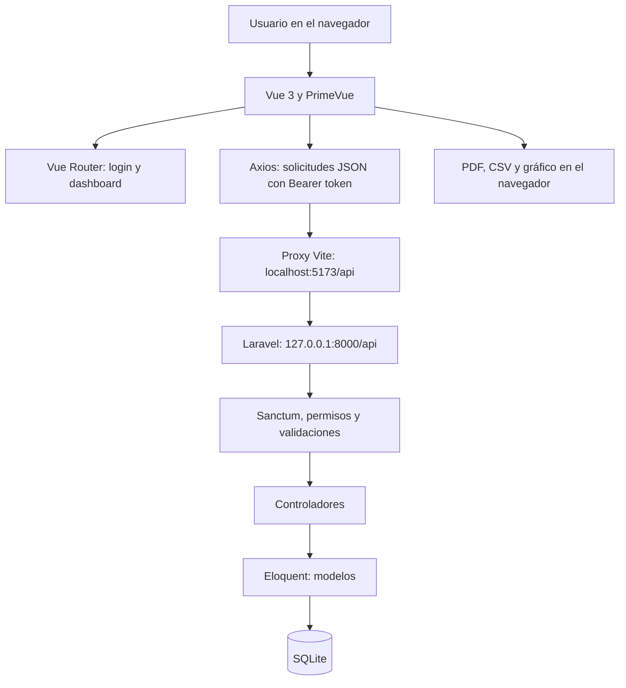
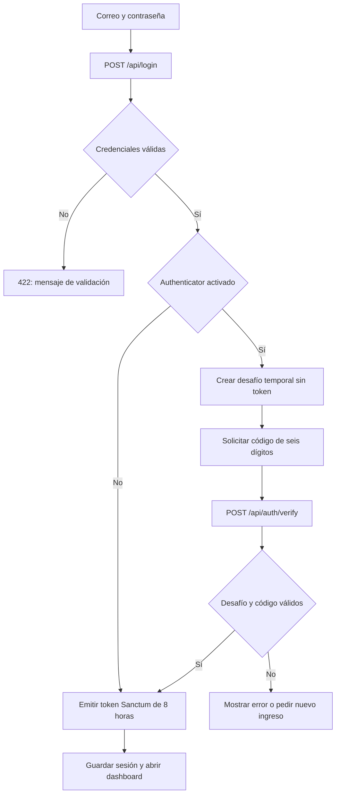
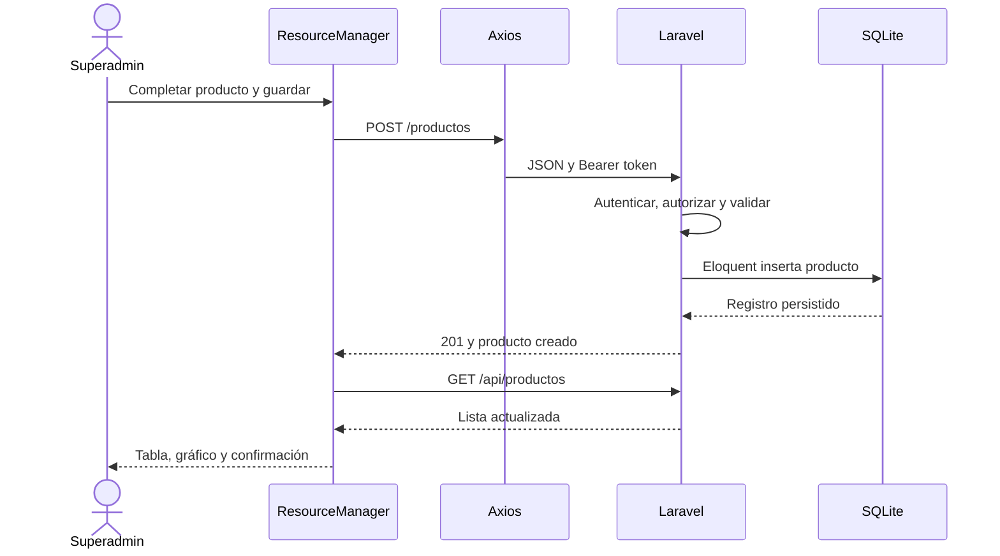
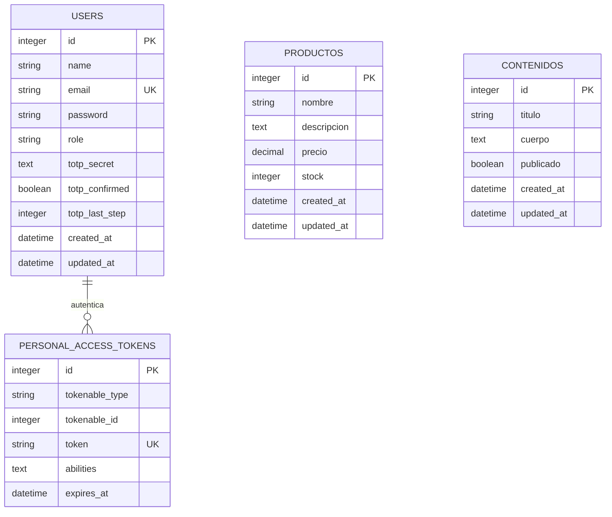

# Documentación técnica y funcional

## Sistema de gestión con Vue, Laravel y SQLite

Fecha de revisión: 17 de octubre de 2026. Documento basado en el código del proyecto.

## 1. Objetivo y alcance

La aplicación permite administrar usuarios, productos y contenidos desde un panel web. Combina una interfaz de una sola página (SPA) desarrollada con Vue y una API HTTP desarrollada con Laravel. Los datos se conservan en SQLite.

Las funciones principales son iniciar y cerrar sesión, controlar el acceso según el rol, mantener el inventario, publicar contenidos, exportar reportes y activar voluntariamente Google Authenticator. No implementa ventas, facturación ni movimientos históricos de inventario: el stock representa la existencia registrada de cada producto.

### Roles

| Operación | Superadmin | Usuario |
| --- | --- | --- |
| Iniciar sesión y gestionar su Authenticator | Sí | Sí |
| Consultar productos y exportarlos | Sí | Sí |
| Crear, editar y eliminar productos | Sí | No |
| Administrar usuarios y roles | Sí | No |
| Consultar contenidos publicados | Sí | Sí |
| Consultar borradores y administrar contenidos | Sí | No |

La interfaz oculta las acciones que no corresponden al usuario. Laravel vuelve a comprobar los permisos en cada solicitud; modificar la interfaz o el almacenamiento del navegador no concede permisos en el servidor.

## 2. Arquitectura general



**Frontend:** presenta formularios, tablas, mensajes y gráficos. Recoge datos y consume la API. La navegación entre login y dashboard se realiza sin cargar una página HTML distinta en cada operación.

**Backend:** valida las solicitudes, autentica a los usuarios, comprueba los roles y ejecuta las operaciones sobre los datos. Devuelve respuestas JSON y códigos HTTP.

**Persistencia:** Eloquent relaciona los modelos PHP con las tablas SQLite. Las migraciones describen cómo crear y modificar el esquema. SQLite utiliza un archivo local, sin un servidor de base de datos separado.

**Conexión en desarrollo:** `vite.config.js` redirige `/api` hacia `http://127.0.0.1:8000`. Por ello deben estar funcionando ambos servidores. En producción, ese proxy de desarrollo debe sustituirse por la configuración del servidor web o por una URL de API explícita.

## 3. Tecnologías: dónde y cómo se aplican

Las versiones de esta tabla corresponden a las ramas declaradas en los manifiestos. Los archivos `package-lock.json` y `backend/composer.lock` fijan las versiones resueltas.

| Tecnología | Aplicación concreta | Ubicación principal |
| --- | --- | --- |
| Vue 3.5 | Componentes, formularios y estado reactivo con `ref`, `computed` y `onMounted` | `src/views/`, `src/components/` |
| Vue Router 5 | Rutas, redirecciones y validación de sesión antes del dashboard | `src/router/index.js` |
| Axios 1.20 | Cliente HTTP centralizado e interceptores para token y errores 401 | `src/service/api.js` |
| PrimeVue 4.5 y tema Aura | Tablas, diálogos, botones, formularios, mensajes y paginación | `src/main.js`, `src/plugins/primevue.js` |
| Vite 8.2 | Servidor frontend, proxy de desarrollo y compilación | `vite.config.js` |
| PHP / Laravel 13 | API, rutas, validaciones y lógica de negocio | `backend/routes/api.php`, `backend/app/` |
| Eloquent | Consultas y persistencia mediante modelos | `backend/app/Models/` |
| Laravel Sanctum 4.3 | Tokens Bearer, protección de rutas y revocación | `AuthController.php`, `User.php` |
| SQLite | Base local de usuarios, recursos, tokens y tablas auxiliares | `backend/database/database.sqlite` |
| Google2FA 9.1 | Generación de secretos y validación de códigos temporales TOTP | `AuthenticatorController.php`, `AuthController.php` |
| qrcode 1.5 | Generación local de la imagen QR para vincular Authenticator | `src/components/AccountSecurity.vue` |
| TanStack Charts 1.1 | Gráfico de barras SVG, escalas y tooltip | `src/components/ProductStockChart.vue` |
| jsPDF 4.2 y AutoTable 5 | Documentos PDF con encabezados y tablas | `src/utils/reports.js` |
| Blob y API de descargas del navegador | Exportación CSV UTF-8 | `src/utils/reports.js` |
| PHPUnit 12.5 | Pruebas de API, permisos, CRUD y autenticación | `backend/tests/` |
| Vitest 4.1 y Vue Test Utils | Pruebas de componentes, gráficos y reportes | `src/components/__tests__/` |
| Cypress 16 | Infraestructura de pruebas de navegador; contiene un ejemplo básico | `cypress/e2e/example.cy.js` |
| Composer y npm | Instalación reproducible de dependencias | `backend/composer.json`, `package.json` |
| Tinker, Pint, ESLint, Oxlint y Prettier | Consola de Laravel, formato y análisis del código | Manifiestos y configuración del proyecto |

**Distinción importante:** `chart.js` está declarado como dependencia, pero el gráfico de inventario revisado utiliza TanStack Charts. Estar instalado no demuestra que una librería participe en el flujo principal.

## 4. Organización del código

```text
fronted_api2/
  src/
    main.js                       Inicialización de Vue y PrimeVue
    router/index.js               Navegación y protección de rutas
    service/api.js                Axios y almacenamiento de sesión
    views/auth/LoginAuth.vue      Login y verificación de código
    views/dashboardView.vue       Panel y opciones según rol
    views/productos/ProductoTable.vue
    components/ResourceManager.vue    CRUD compartido
    components/AccountSecurity.vue    Configuración de Authenticator
    components/ProductStockChart.vue  Inventario visual
    utils/reports.js               PDF y CSV
    components/__tests__/         Pruebas frontend
  backend/
    routes/api.php                Endpoints HTTP
    routes/console.php            Comandos de administración
    app/Http/Controllers/         Autenticación y gestión
    app/Models/                   User, Producto y Contenido
    database/migrations/          Esquema de base de datos
    database/seeders/             Administrador y datos de ejemplo
    tests/                        Pruebas backend
  vite.config.js                  Proxy y configuración frontend
```

Las rutas activas son `/login`, `/dashboard`, la redirección de `/` al dashboard y una vista para rutas inexistentes. Otros componentes de ejemplo presentes en el repositorio no implican que exista una sección adicional en el panel.

## 5. Autenticación y sesión

### Flujo de ingreso



1. `LoginAuth.vue` envía el correo y la contraseña mediante `useAuthService()`.
2. `AuthController` valida el formato del correo y compara la contraseña con el hash almacenado mediante `Hash::check`.
3. Si el segundo factor está desactivado, Sanctum emite un token con vencimiento de ocho horas.
4. Si está activado, se devuelve un desafío aleatorio de 64 caracteres y se solicita el código TOTP. El token se emite después de verificarlo.
5. `api.js` guarda `auth_token` y `user_data` en `localStorage`. Su interceptor añade `Authorization: Bearer <token>` a las siguientes solicitudes.
6. Antes de abrir el dashboard, Vue Router consulta `/api/user` para comprobar que la sesión siga siendo válida.
7. Al salir, `/api/logout` elimina el token actual y el frontend borra su sesión local. Una respuesta 401 también limpia la sesión y redirige al login.

El token almacenado por Sanctum se conserva como hash en la base de datos. El navegador necesita el token original para enviarlo en las peticiones. El almacenamiento en `localStorage` conserva el ingreso al recargar, pero requiere controlar especialmente cualquier posibilidad de ejecución de JavaScript no confiable.

### Segundo factor opcional

Desde **Mi cuenta / Seguridad**, el usuario valida su contraseña y solicita la configuración. Laravel genera un secreto y una URI `otpauth`. Vue convierte esa URI en un QR con `qrcode`; no necesita un servicio externo de imágenes.

La configuración queda pendiente en caché, asociada al usuario y a su token actual, hasta confirmar un código correcto. Solo entonces se almacena el secreto cifrado y se activa `totp_confirmed`. Al activarlo se revocan los otros tokens del usuario. Para desactivarlo se solicitan contraseña y código actual.

El desafío de login y la configuración pendiente nacen con cinco minutos de vigencia. Durante los reintentos, el código actual reescribe su vencimiento a dos minutos. El quinto intento inválido consume el desafío o la configuración pendiente. También se aplican límites de frecuencia en las rutas.

La verificación de login registra el último paso temporal utilizado para impedir reutilizar el mismo código. Los bloqueos de caché y la transacción ayudan a controlar solicitudes simultáneas. Los códigos proceden de la aplicación Authenticator; no se envían por correo.

## 6. CRUD: cómo se construyó la gestión

CRUD significa crear, consultar, actualizar y eliminar. El proyecto evita repetir un formulario y una tabla completa para cada recurso.

**En Vue:** `ResourceManager.vue` recibe `resource`, `title`, `fields` y `editable`. Con esas propiedades genera columnas, formulario, búsqueda, paginación, acciones y exportaciones. `ProductoTable.vue` configura los campos del producto; el dashboard configura usuarios y contenidos.

**En Laravel:** `ManagementController` selecciona el modelo según el recurso permitido, comprueba el rol y aplica reglas específicas antes de guardar. Las rutas restringen los recursos a `usuarios`, `productos` y `contenidos`.



Al editar se utiliza `PUT`; al eliminar, `DELETE` después del diálogo de confirmación. Tras guardar o eliminar se vuelve a consultar la lista. La búsqueda se calcula en el navegador sobre los registros recibidos y no distingue mayúsculas de minúsculas. La tabla pagina de cinco en cinco inicialmente, con opciones de diez y veinte.

### Validaciones relevantes

| Recurso | Reglas importantes del backend |
| --- | --- |
| Usuario | Nombre obligatorio de hasta 120 caracteres; correo válido y único; rol `user` o `superadmin`; contraseña de 10 a 128 caracteres en el CRUD, obligatoria al crear y opcional al editar |
| Producto | Nombre hasta 150 caracteres; descripción opcional hasta 5.000; precio numérico entre 0 y 9.999.999.999,99; stock entero entre 0 y 100.000.000 |
| Contenido | Título hasta 180 caracteres; cuerpo obligatorio hasta 20.000; publicado booleano |

El administrador no puede eliminar su propia cuenta ni quitarse su propio rol desde este CRUD. Cambiar la contraseña o el rol de un usuario revoca sus tokens. Eliminar al usuario también elimina sus tokens.

Los usuarios normales solo reciben contenidos publicados. Pedir por ID un borrador devuelve 404. El cuerpo del contenido se muestra como texto mediante interpolación de Vue, sin interpretar HTML.

## 7. Modelo de datos



El diagrama resume los campos relevantes; las migraciones son la definición completa. La relación de tokens es polimórfica mediante `tokenable_type` y `tokenable_id`, no una clave foránea directa a usuarios.

**No hay relaciones implementadas entre productos y contenidos, ni campos de autor o propietario en esos recursos.** No se debe interpretar el diagrama como un sistema de ventas o de contenidos con autoría.

Además existen tablas auxiliares de caché y bloqueos, sesiones, restablecimiento de contraseñas y trabajos en cola. Que existan esas tablas no implica que haya pantallas de recuperación de contraseña, procesos de correo o tareas en segundo plano implementados. El acceso de esta SPA utiliza tokens Sanctum.

`User` oculta contraseña y campos TOTP en las respuestas JSON. Su cast `hashed` transforma las contraseñas al asignarlas y `encrypted` cifra el secreto TOTP usando la clave de la aplicación. `Producto` convierte stock a entero y precio a decimal con dos posiciones; `Contenido` convierte publicado a booleano.

## 8. Reportes y visualización del inventario

Las exportaciones y el gráfico utilizan el conjunto filtrado, antes de aplicar la paginación visual de la tabla. Una búsqueda con 30 coincidencias exporta las 30, aunque la tabla muestre cinco por página.

**CSV:** `exportCsv()` construye encabezados y filas, añade una marca UTF-8 para conservar acentos y descarga un `Blob`. Escapa comillas y antepone un apóstrofo a valores que podrían interpretarse como fórmulas al abrirlos en una hoja de cálculo.

**PDF:** `createPdf()` carga dinámicamente jsPDF y AutoTable, escribe el título y genera la tabla. `exportPdf()` descarga el documento. Esta carga se realiza al solicitar la exportación.

**Gráfico:** `ProductStockChart.vue` ordena por existencia descendente y muestra como máximo diez productos. Usa barras horizontales, escalas y tooltip de TanStack Charts. Las barras naranjas representan menos de diez unidades. También muestra cantidad de productos filtrados, suma de existencias y valor total en dólares.

```text
Unidades disponibles = suma(stock)
Valor del inventario = suma(precio × stock)
```

Por ejemplo, dos unidades a USD 10 y tres unidades a USD 5 representan cinco unidades y USD 35 de inventario. Los indicadores incluyen todos los productos filtrados; solo las barras se limitan a diez. Vue recalcula estos valores cuando cambia la búsqueda o se recarga el listado después del CRUD.

## 9. API y respuestas HTTP

### Autenticación

| Método y ruta | Función | Acceso |
| --- | --- | --- |
| `POST /api/login` | Validar credenciales o iniciar desafío | Público, limitado a 5 solicitudes por minuto |
| `POST /api/auth/verify` | Verificar desafío TOTP y emitir token | Público con desafío, 10 solicitudes por minuto |
| `GET /api/user` | Consultar usuario autenticado | Token |
| `POST /api/logout` | Revocar token actual | Token |
| `GET /api/auth/authenticator` | Consultar estado del segundo factor | Token |
| `POST /api/auth/authenticator/setup` | Generar configuración pendiente | Token y contraseña |
| `POST /api/auth/authenticator/confirm` | Confirmar activación | Token y código |
| `DELETE /api/auth/authenticator` | Desactivar segundo factor | Token, contraseña y código |

Las tres rutas que modifican Authenticator también tienen limitación de frecuencia de 10 solicitudes por minuto.

### Recursos

El siguiente patrón aplica a `usuarios`, `productos` y `contenidos`. Todos requieren token; también se aplican los permisos descritos en la matriz de roles.

| Método | Ruta | Resultado |
| --- | --- | --- |
| GET | `/api/{recurso}` | Lista de registros permitidos, ordenada por ID descendente |
| GET | `/api/{recurso}/{id}` | Registro permitido |
| POST | `/api/{recurso}` | Crear; respuesta 201 |
| PUT | `/api/{recurso}/{id}` | Actualizar; respuesta 200 |
| DELETE | `/api/{recurso}/{id}` | Eliminar; respuesta 204 |

Los errores más importantes son 401 para sesión ausente o inválida, 403 para falta de permisos, 404 para recurso inexistente o borrador no accesible, 422 para validación y 429 para exceso de solicitudes. En este proyecto una contraseña incorrecta en login produce 422 mediante un error de validación.

## 10. Seguridad aplicada y límites actuales

| Medida implementada | Qué resuelve |
| --- | --- |
| Hash de contraseñas | Evita almacenarlas en texto plano |
| Tokens con expiración y revocación | Limita la duración de acceso y permite cerrar sesiones |
| Middleware `auth:sanctum` | Rechaza solicitudes sin autenticación válida |
| Autorización en el controlador | Protege operaciones aunque se altere la interfaz |
| Validación antes de persistir | Controla formato, longitud y rangos |
| TOTP opcional con secreto cifrado | Añade un segundo factor para quienes lo activan |
| Límites, desafío temporal y protección contra reutilización | Reduce abuso de los intentos de autenticación |
| Texto escapado y CSV protegido | Reduce riesgos al mostrar contenidos y exportar datos |

Aspectos pendientes para un entorno público: HTTPS, configuración de producción, políticas de respaldo, gestión de secretos y evaluación del almacenamiento del token. `APP_KEY` es necesaria para descifrar los secretos TOTP: debe resguardarse junto con una estrategia de recuperación, sin publicarla.

La lista de recursos se devuelve completa y se filtra en el navegador. Para un volumen grande convendría implementar búsqueda y paginación en la API y revisar los límites de concurrencia de SQLite. No hay bitácora de auditoría, copias de seguridad automatizadas ni códigos de recuperación TOTP implementados en los flujos revisados.

## 11. Puesta en marcha y operación local

### Requisitos reales

- PHP compatible con las dependencias instaladas. Aunque `composer.json` declara `^8.3`, el control de plataforma instalado exige **PHP 8.4.1 o superior**. En esta sesión se utilizó PHP 8.5.11.
- Extensiones PHP para SQLite (`pdo_sqlite` y `sqlite3`) y las requeridas por Laravel y Composer; en el entorno temporal también se habilitaron mbstring, OpenSSL, fileinfo, curl, intl y zip.
- Composer y Node compatibles. `package.json` declara Node `^22.18.0` o `>=24.12.0`.

### Primera instalación

Desde la raíz, en PowerShell:

```powershell
npm.cmd install
Copy-Item .env.example .env
cd backend
composer install
Copy-Item .env.example .env
php artisan key:generate --no-interaction
if (!(Test-Path database/database.sqlite)) { New-Item database/database.sqlite -ItemType File }
php artisan migrate --no-interaction
php artisan app:create-admin
```

La copia de archivos `.env` y la generación de clave son pasos de instalación inicial. En una instalación existente se conservan la configuración y la clave. El comando `app:create-admin` es interactivo: solicita nombre, correo y contraseña oculta. El rol creado es `superadmin`.

### Arranque habitual

Terminal del backend, dentro de `backend/`:

```powershell
php artisan serve --host=127.0.0.1 --port=8000 --no-reload
```

Terminal del frontend, en la raíz:

```powershell
npm.cmd run dev
```

Abrir `http://localhost:5173`. Si `php -v` muestra PHP 8.2 de XAMPP, ese ejecutable no sirve para las dependencias actuales. Durante la resolución del error se descargó un runtime temporal, sin sustituir XAMPP. Para reutilizarlo mientras siga disponible:

```powershell
cd backend
$phpRuntime = Join-Path $env:TEMP 'fronted-api2-php85'
$env:PHPRC = $phpRuntime
& (Join-Path $phpRuntime 'php.exe') artisan serve --host=127.0.0.1 --port=8000 --no-reload
```

Para una instalación permanente se debe configurar un PHP compatible en el entorno. Una carpeta temporal puede ser eliminada por el sistema. El servidor iniciado durante esta sesión no se configura como servicio de inicio automático.

### Incidencia resuelta: error 502 en login

El navegador podía abrir Vue, pero el proxy no tenía un backend escuchando en el puerto 8000. Además, el PHP predeterminado era 8.2.12 e impedía ejecutar Laravel. Se preparó PHP 8.5, se habilitó SQLite y se inició el backend. Después se comprobó el login tanto directamente en Laravel como pasando por el proxy de Vue, con el rol `superadmin`.

La cuenta local del administrador es `geovani@gmail.com`. Su contraseña no se incorpora a esta documentación. El código no contiene credenciales predeterminadas para esa cuenta.

### Comandos útiles

```powershell
# Desde backend/
php artisan migrate:status --no-interaction
php artisan route:list --path=api --no-interaction
php artisan db:seed --class=DemoSeeder --no-interaction
php artisan app:reset-authenticator correo@example.com
php artisan tinker
```

`DemoSeeder` solo se ejecuta en local o testing; agrega ocho productos y cuentas de demostración sin sobrescribir los registros existentes. `DatabaseSeeder` permite crear un administrador usando `ADMIN_EMAIL` y `ADMIN_PASSWORD` del entorno. El comando para restablecer Authenticator requiere confirmación, desactiva el segundo factor y revoca los tokens del usuario.

## 12. Pruebas y comprobación del proyecto

La estructura permite comprobar frontend y backend por separado. No se debe confundir la existencia de un test con la evidencia de que pasó en una ejecución concreta.

| Archivo o grupo | Qué comprueba |
| --- | --- |
| `backend/tests/Feature/ApiTest.php` | Login, revocación, roles, validación, CRUD y restricciones de cuenta |
| `AuthSecurityTest.php` | Desafíos expirados, secreto oculto, reutilización de códigos y límite de intentos |
| `AuthenticatorSettingsTest.php` | Configuración, confirmación, expiración, contraseña y desactivación |
| `DemoSeederTest.php` | Datos de demostración y conservación de registros editados |
| `ResourceManager.spec.js` | Crear, listar, editar, eliminar y presentar errores |
| `LoginAuth.spec.js` y `AccountSecurity.spec.js` | Flujo visual del segundo factor y activación confirmada |
| `Reports.spec.js` | PDF real y CSV con acentos, comillas y protección de fórmulas |
| `ProductStockChart.spec.js` | Renderizado SVG, cambios de totales y estado vacío |
| `cypress/e2e/example.cy.js` | Ejemplo básico de navegación; no constituye cobertura completa del sistema |

`backend/phpunit.xml` utiliza SQLite en memoria para las pruebas y almacenes temporales para caché y sesiones. Esto separa las verificaciones de la base local del administrador.

```powershell
# Backend, usando PHP compatible
cd backend
php artisan test --compact

# Frontend, desde la raíz
cd ..
npm.cmd run test:unit -- --run
npm.cmd run build
```

La metodología que estructura estas verificaciones consiste en definir el comportamiento esperado, implementarlo y ejecutar pruebas para detectar regresiones. El orden histórico exacto de cada cambio no se deduce únicamente del estado actual del código.

### Resultado de verificación de esta entrega

El 17 de octubre de 2026 se ejecutaron las suites del proyecto: backend, 18 pruebas aprobadas y 112 aserciones; frontend, 12 pruebas aprobadas en 6 archivos. Estos resultados corresponden al entorno local de esta revisión. No se ejecutaron Cypress ni una compilación de producción como parte de esta entrega documental.

## 13. Explicación breve para una exposición

1. **Problema:** necesitamos gestionar inventario, usuarios y publicaciones con permisos diferentes.
2. **Arquitectura:** Vue presenta la interfaz, Axios comunica, Laravel valida y controla el acceso, y SQLite conserva los datos.
3. **Reutilización:** un componente Vue y un controlador Laravel comparten el patrón CRUD, con campos y validaciones según el recurso.
4. **Seguridad:** Sanctum identifica al usuario; el rol determina sus permisos; Authenticator añade un segundo factor voluntario.
5. **Información útil:** el usuario puede buscar, exportar PDF o CSV y consultar existencias y valor del inventario con un gráfico reactivo.
6. **Calidad:** hay pruebas de API y componentes para los flujos principales, con una base aislada de pruebas.
7. **Aprendizaje de operación:** para funcionar en desarrollo deben estar activos Vue y Laravel, con una versión de PHP compatible y SQLite habilitado.

### Ejemplo de demostración

Ingresar como administrador, crear un producto, buscarlo, editar sus existencias y observar el gráfico. Exportar la búsqueda como PDF y CSV. Crear un contenido en borrador y después publicarlo. Comparar la vista con una cuenta de consulta. Finalmente, mostrar la pantalla de seguridad y explicar cómo se confirma la activación de Authenticator.

## 14. Referencias internas

Las fuentes de esta guía son los archivos del propio proyecto: `package.json`, `backend/composer.json`, `vite.config.js`, los componentes de `src/`, los controladores y modelos de `backend/app/`, `backend/routes/api.php`, `backend/routes/console.php`, las migraciones y las pruebas enumeradas. Los diagramas describen esa implementación y no agregan módulos inexistentes.
